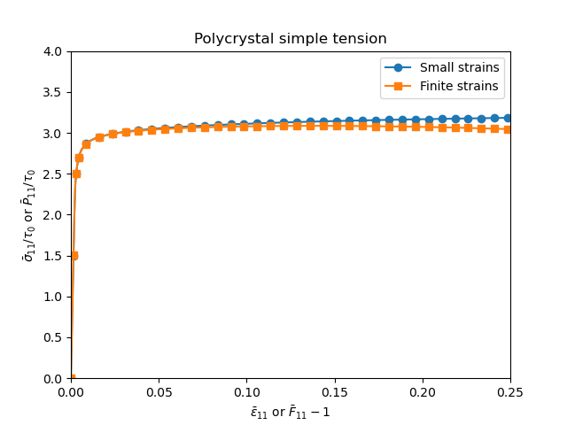

% Small-strain and finite-strain crystal viscoplasticity of a polycrystal

This demo, contributed by Jean-Michel Scherer, is dedicated to the
tension of a polycrystal in which each grain has an orientation
dependent viscoplastic behaviour, as proposed in @meric_single_1991.
Compared to the other demos, it illustrates the handling of a rate
dependent behaviour, through the time increment given to the problem,
and of a rotation matrix varying from one grain to another.

As the `mgis.fenics` module, this demo requires the legacy version of
`FEniCS` (`DOLFIN` 2019.2), not `FEniCSx`. It was tested with the
`DOLFIN` packages of Ubuntu 24.04 and 26.04, with `numpy` 1.26 and 2.3.

> **Source files:**
>
> * Jupyter notebook: [mgis_fenics_polycrystal.ipynb](demos/mgis_fenics_polycrystal/mgis_fenics_polycrystal.ipynb)
> * Python file: [mgis_fenics_polycrystal.py](demos/mgis_fenics_polycrystal/mgis_fenics_polycrystal.py)
> * MFront behaviour files: [FCCMericCailletaudSingleCrystalViscoPlasticity.mfront](demos/mgis_fenics_polycrystal/FCCMericCailletaudSingleCrystalViscoPlasticity.mfront),
>   [FCCMericCailletaudFiniteStrainSingleCrystalViscoPlasticity.mfront](demos/mgis_fenics_polycrystal/FCCMericCailletaudFiniteStrainSingleCrystalViscoPlasticity.mfront)
> * Mesh and orientations: [n20-id1.xdmf](demos/mgis_fenics_polycrystal/meshes/n20-id1.xdmf),
>   [n20-id1.h5](demos/mgis_fenics_polycrystal/meshes/n20-id1.h5),
>   [n20-id1.ori](demos/mgis_fenics_polycrystal/meshes/n20-id1.ori)
>
> The behaviours are compiled in the directory of the demo, the mesh
> files being stored in the `meshes` subdirectory:
>
> ~~~~{.bash}
> $ mfront --obuild --interface=generic FCCMericCailletaudSingleCrystalViscoPlasticity.mfront \
>     FCCMericCailletaudFiniteStrainSingleCrystalViscoPlasticity.mfront
> ~~~~

# Multiplicative and additive decompositions

At finite strains, the deformation gradient $\boldsymbol{F}$ is
decomposed into an elastic part $\boldsymbol{F}_e$ and a plastic part
$\boldsymbol{F}_p$ such that
$\boldsymbol{F} = \boldsymbol{F}_e\cdot\boldsymbol{F}_p$. The
deformation rate is then:

$$
\dot{\boldsymbol{F}}\cdot\boldsymbol{F}^{-1} =
\dot{\boldsymbol{F}}_e\cdot\boldsymbol{F}_e^{-1} +
\boldsymbol{F}_e\cdot\dot{\boldsymbol{F}}_p\cdot\boldsymbol{F}_p^{-1}\cdot\boldsymbol{F}_e^{-1}
$$

In the crystal plasticity framework, the plastic deformation rate is
decomposed into a sum of plastic slip rates:

$$
\dot{\boldsymbol{F}}_p\cdot\boldsymbol{F}_p^{-1} =
\sum_{s=1}^{N_s}\dot{\gamma}^s\,\boldsymbol{m}^s\otimes\boldsymbol{n}^s =
\sum_{s=1}^{N_s}\dot{\gamma}^s\,\boldsymbol{N}^s
$$

The sum is computed over a set of $N_s$ slip systems, each defined by a
slip direction $\boldsymbol{m}^s$ and a slip plane normal
$\boldsymbol{n}^s$. More details about the multiplicative decomposition
in the context of crystal plasticity are given in the documentation of
`MFront` on the [implicit integration of finite strain behaviours based
on a multiplicative decomposition of the deformation
gradient](https://thelfer.github.io/tfel/web/FeFpImplicitPlasticity.html).

Under the small strain assumption, the total strain
$\boldsymbol{\varepsilon}$ is decomposed into an elastic part
$\boldsymbol{\varepsilon}_e$ and a plastic part
$\boldsymbol{\varepsilon}_p$. Similarly, the plastic strain rate is
decomposed as a sum of plastic slip rates:

$$
\dot{\boldsymbol{\varepsilon}}_p =
\sum_{s=1}^{N_s}\dfrac{\dot{\gamma}^s}{2}\left(\boldsymbol{m}^s\otimes\boldsymbol{n}^s+\boldsymbol{n}^s\otimes\boldsymbol{m}^s\right) =
\sum_{s=1}^{N_s}\dot{\gamma}^s\,\operatorname{sym}\left(\boldsymbol{N}^s\right)
$$

# Stress measures

At finite strains, the resolved shear stress acting on a slip system
$s$ is the projection of the Mandel stress tensor $\boldsymbol{M}$ on
the slip plane $\boldsymbol{n}^s$ in the slip direction
$\boldsymbol{m}^s$, i.e.
$\tau^s = \boldsymbol{M}\,\colon\,\boldsymbol{N}^s$. The Mandel stress
tensor can be expressed in terms of the Cauchy stress tensor
$\boldsymbol{\sigma}$ and of the elastic part of the deformation
gradient:
$\boldsymbol{M} = \det\left(\boldsymbol{F}_e\right)\,\boldsymbol{F}_e^{T}\cdot\boldsymbol{\sigma}\cdot\boldsymbol{F}_e^{-T}$.

Under the small strain assumption, the Mandel stress coincides with the
Cauchy stress, so that the resolved shear stress acting on a system $s$
is
$\tau^s = \boldsymbol{\sigma}\,\colon\,\operatorname{sym}\left(\boldsymbol{N}^s\right)$.

# `MFront` implementation

The implementation of the Méric-Cailletaud phenomenological model is
described in details in the [`MFront`
documentation](https://thelfer.github.io/tfel/web/MericCailletaudSingleCrystalPlasticity.html)
for small and finite strains. Here we only recall the finite strain
implementation.

The `FiniteStrainSingleCrystal` brick computes the second
Piola-Kirchhoff stress in the intermediate configuration
$\boldsymbol{S}_e$ from the elastic Green-Lagrange strain tensor
$\boldsymbol{\varepsilon}^{GL}_e = \dfrac{1}{2}\left(\boldsymbol{F}_e^{T}\cdot\boldsymbol{F}_e - \boldsymbol{I}\right)$
as follows:
$\boldsymbol{S}_e = \mathbf{D}\,\colon\,\boldsymbol{\varepsilon}^{GL}_e$,
where $\mathbf{D}$ is the stiffness tensor. The elastic strain `eel` of
the brick is this Green-Lagrange strain. `MFront` allows to define
orthotropic behaviours with 9 independent elastic parameters. Here, we
consider a material with cubic symmetry by setting equal values to the
Young moduli, to the Poisson ratios and to the shear moduli. The
`shifted_elastic_deformation_gradient` flag is set to `true` so that
the elastic part of the deformation gradient is initialized to the
identity.

Several auxiliary state variables are defined. They are persistent
variables, but not integration variables, and are available for
post-processing.

```cpp
@DSL ImplicitFiniteStrain;
@Behaviour FCCMericCailletaudFiniteStrainSingleCrystalViscoPlasticity;
@Author Thomas Helfer, Jean-Michel Scherer;
@Date 02 / 11 / 2022;
@Description {
  Meric-Cailletaud single crystal viscoplasticity for FCC crystals,
  at finite strains
}

@ModellingHypothesis Tridimensional;
@OrthotropicBehaviour;

@Algorithm NewtonRaphson;
@Epsilon 1.e-14;
@Theta 1;

@Brick FiniteStrainSingleCrystal{
  young_modulus1 : "E",
  young_modulus2 : "E",
  young_modulus3 : "E",
  poisson_ratio12 : "nu",
  poisson_ratio23 : "nu",
  poisson_ratio13 : "nu",
  shear_modulus12 : "G",
  shear_modulus23 : "G",
  shear_modulus13 : "G",
  shifted_elastic_deformation_gradient : true
};

@CrystalStructure FCC;
@SlipSystem<0, 1, -1>{1, 1, 1};
@InteractionMatrix{1, 0., 0., 0., 0., 0., 0.};

@MaterialProperty real E;    // Young modulus (stress)
@MaterialProperty real nu;   // Poisson ratio
@MaterialProperty real G;    // Shear modulus (stress)
@MaterialProperty real n;    // Viscosity law exponent
@MaterialProperty real K;    // Viscosity law coefficient (stress)
@MaterialProperty real Q;    // Isotropic hardening law modulus (stress)
@MaterialProperty real b;    // Isotropic hardening law parameter
@MaterialProperty real tau0; // Initial CRSS (stress)
@MaterialProperty real d;    // Kinematic hardening law parameter
@MaterialProperty real C;    // Kinematic hardening law modulus (stress)

@AuxiliaryStateVariable strain p[Nss];
p.setEntryName("EquivalentViscoplasticSlip");

@AuxiliaryStateVariable strain a[Nss];
a.setEntryName("BackStrain");

@AuxiliaryStateVariable stress tau[Nss];
tau.setEntryName("ResolvedShearStress");

@AuxiliaryStateVariable tensor<3u,real> Fp;
Fp.setEntryName("PlasticPartOfTheDeformationGradient");
```

Rate dependent viscoplastic flow rules are adopted, so that the
residual equations of the plastic slip increments are given by:

$$
\begin{aligned}
\Delta\gamma^s &= \Delta t \left\langle \dfrac{\left|\tau^s-x^s\right| - r^s}{K} \right\rangle^n\operatorname{sign}\left(\tau^s-x^s\right)\\
\text{with}\quad r^s &= \tau_0 + Q\sum_{k=1}^{N_s}h^{sk}\left(1-\exp\left(-b\,p^k\right)\right)\\
x^s &= C\,\alpha^s\\
\Delta\alpha^s &= \Delta\gamma^s - d\,\alpha^s\,\Delta p^s\\
\Delta p^s &= \left|\Delta \gamma^s\right|
\end{aligned}
$$

The rate sensitivity of this viscoplastic behaviour is reflected by the
dependence of the evolution equations on the time step $\Delta t$. In
the `@Integrator` block, the above residuals are discretized using a
$\theta$-method and stored in the vector `fg`. Note that the resolved
shear stresses `tau[i]` are computed from the Mandel stress `M` and the
Schmid tensors `ss.mu[i]`, which are automatically defined by `MFront`
for a finite strain crystal plasticity behaviour.

```cpp
@Integrator {
  using size_type = unsigned short;
  const auto& m = ss.him;
  real exp_bp[Nss];
  for (size_type i = 0; i != Nss; ++i) {
      const auto p_ = p[i] + theta * abs(dg[i]);
      exp_bp[i] = exp(-b * p_);
  }
  for (size_type i = 0; i != Nss; ++i) {
    tau[i] = M | ss.mu[i];
    auto r = tau0;
    for (size_type j = 0; j != Nss; ++j) {
      r += Q * m(i, j) * (1 - exp_bp[j]);
    }
    const auto da =  //
        (dg[i] - d * a[i] * abs(dg[i])) / (1 + theta * d * abs(dg[i]));
    const auto x = C * (a[i] + theta * da);
    const auto f = max(abs(tau[i] - x) - r, stress(0));
    // a test such as `if (f > 1.1 * K) { return false; }` would reject
    // the iterations leading to a too large viscoplastic slip rate, but
    // requires the calling code to reduce the time step when the
    // integration fails, which the demo does not do
    const auto sgn = tau[i] - x > 0 ? 1 : -1;
    // viscoplasticity
    const auto v = pow(f / K, n);
    const auto dv = (n / K) * pow(f / K, n - 1);
    fg[i] -= dt * v * sgn;
    dfg_ddeel(i) = -dt * dv * (ss.mu[i] | dM_ddeel);
    const auto sgn_gi = dg(i) > 0 ? 1 : -1;
    const auto dda_ddg =
        (1 - d * a[i] * sgn_gi) / (power<2>(1 + theta * d * abs(dg[i])));
    dfg_ddg(i, i) += dt * dv * C * theta * dda_ddg;
    for (size_type j = 0; j != Nss; ++j) {
      const auto sgn_gj = dg(j) > 0 ? 1 : -1;
      const auto dr = Q * m(i, j) * theta * b * exp_bp[j] * sgn_gj;
      dfg_ddg(i, j) += dt * dv * dr * sgn;
    }
  }
}
```

The `MFront` documentation suggests rejecting the Newton steps leading
to too high values of $f$ with a test such as
`if (f > 1.1 * K) { return false; }`. This test is designed for Norton
exponents between $70$ and $100$, for which $f$ is almost equal to $K$
at the solution. According to the flow rule, the solution satisfies
$f = K\,\left|\dot{\gamma}^s\right|^{1/n}$ on the active slip systems:
with the exponent $n=5$ of this demo, the test also rejects the
solution as soon as a slip rate exceeds $1.1^{5} \approx 1.6$
$\mathrm{s}^{-1}$. This is the case at the imposed strain rate of
$1$ $\mathrm{s}^{-1}$: the integration of the behaviour fails and the
`MFrontNonlinearProblem` class stops with an error (behaviour
integration failed). With a strain rate a hundred times lower, the
demo runs with this test. It is thus not used here.

After the time integration, the auxiliary state variables are updated
in the `@UpdateAuxiliaryStateVariables` block. Finally, the plastic
dissipation and the elastic stored energy are computed in the
`@DissipatedEnergy` and `@InternalEnergy` blocks respectively.

```cpp
@UpdateAuxiliaryStateVariables {
  using size_type = unsigned short;
  for (size_type i = 0; i != Nss; ++i) {
    p[i] += abs(dg[i]);
    const auto da =  //
        (dg[i] - d * a[i] * abs(dg[i])) / (1 + theta * d * abs(dg[i]));
    a[i] += da;
  }
  Fp = invert(Fe+tensor<3u,real>::Id())*F1;
}

@DissipatedEnergy {
  using size_type = unsigned short;
  for (size_type i = 0; i != Nss; ++i) {
    Psi_d += tau[i] * dg[i];
  }
}

@InternalEnergy {
  Psi_s = 0.5 * (convertCauchyStressToSecondPiolaKirchhoffStress(sig, Fe+tensor<3u,real>::Id()) | eel);
}
```

# `FEniCS` implementation

We first define the material parameters, the imposed constant
displacement rate and the duration of the loading. We then load the
finite element mesh of a polycrystal made of 20 grains generated with
[`Neper`](https://neper.info/).

```python
import os
from dolfin import *
try:
    import ufl_legacy as ufl
except ImportError:
    import ufl
import mgis.fenics as mf
import numpy as np
import matplotlib.pyplot as plt
from scipy.spatial.transform import Rotation

behaviours = [
              "FCCMericCailletaudSingleCrystalViscoPlasticity",
              "FCCMericCailletaudFiniteStrainSingleCrystalViscoPlasticity",
             ]

## material parameters
# elasticity constants
E  = 1.
nu = 0.3
G  = E/(1+nu)/2
# initial critical resolved shear stress
tau0 = E/1000.
# viscosity parameters
n_visc = 5.
K_visc = tau0/10.
# isotropic hardening
Q = 1.*tau0
b = 10.
# kinematic hardening
C = 0.
d = 0.

# displacement rate v, final time T and number of loading increments Nincr
v = 1.
T = [.25,.25]
Nincr = 100

# geometry - mesh
xdmf_mesh_file = XDMFFile(MPI.comm_world,"meshes/n20-id1.xdmf")
mesh = Mesh()
xdmf_mesh_file.read(mesh)
mvc = MeshValueCollection("size_t", mesh, 3)
xdmf_mesh_file.read(mvc, "grains")

grains = cpp.mesh.MeshFunctionSizet(mesh, mvc)
facets = MeshFunction("size_t", mesh, 2, 0)
dx = Measure('dx', subdomain_data=grains)
```

The facets on the left and right hand sides are respectively marked
with the tags `1` and `2`. Tensile Dirichlet boundary conditions are
applied by fixing the left end and displacing the right end. A 3D
`CG1` vector function space is defined for the displacement field. In
addition, a scalar `DG0` function space is defined to describe the
crystallographic orientation of each grain.

```python
# create boundaries where to impose boundary conditions
class X0(SubDomain):
    def inside(self, x, on_boundary):
        return near(x[0], 0.) and on_boundary
class X1(SubDomain):
    def inside(self, x, on_boundary):
        return near(x[0], 1.) and on_boundary

X0().mark(facets, 1)
X1().mark(facets, 2)

# create function space
Vu  = VectorFunctionSpace(mesh, "CG", degree=1, dim=3)
Vmf = FunctionSpace(mesh, "DG", 0)
```

Each grain of the polycrystal has its own crystallographic orientation.
In general, crystallographic orientations are expressed with Euler
angles, quaternions or rotation matrices. Here, the function
`make_rotation_matrix` builds a rotation matrix field on a given
function space `V`, based on Euler angles provided in a text file with
the `.ori` extension. The user also provides a mesh function `mf` in
which each grain is tagged with a different integer value. The grain
with tag `i` is associated with the three Euler angles at line `i` of
the `.ori` file. Alternatively, the user can provide the components of
the first two columns of the rotation matrix. In both cases, the
rotation matrix is defined as the matrix that brings a vector from the
sample frame into the crystal frame. The Bunge convention (ZXZ) is used
to define the rotation matrix from the Euler angles.

```python
# set the rotation matrix in each grain based on Bunge-Euler angles (ZXZ convention) or rotation matrix columns (1st and 2nd)
def make_rotation_matrix(dim,
                         ori_file,
                         V,
                         mf,
                         convention='from_euler'):
    '''
    Create the rotation matrix R for each grain. By convention, the rotation is done from sample frame
    to crystal frame i.e. V_crystal = R*V_sample).

    Inputs:  * dim: int equal to 2 or 3. If 2, only use phi1 (first angle) to compute the rotation matrix,
                                         while Phi and phi2 are set to 0.
                                         If 3, use phi1, Phi and phi2 to compute the rotation matrix.
             * ori_file: string containing the path to the text file defining Euler angles (in degrees) or
                         1st and 2nd column vectors of the rotation matrix (the 3rd column is deduced).
                         If Euler angles are used, each line contains 3 angles phi1, Phi and phi2 separated
                         by spaces. If vectors are used, the first 3 values define the first column of R, the
                         next three values define the second column of R. Vectors need not be normalized. The
                         orientation defined on line 1 defines the rotation matrix of grain with tag 1, ...
                         orientation defined on line n defines the rotation matrix of grain with tag n. If the
                         file does not exist, it is assumed that the whole mesh has the tag 1 and the default
                         orientation will be phi1=0, Phi=0, phi2=0.
             * V: FunctionSpace on which the rotation matrix is defined.
             * mf: MeshFunction containing the grain tags.
             * convention: string equal to 'from_euler' or 'from_vector' defining the orientation convention used.

    Outputs: * R: Function in the FunctionSpace V defining the local rotation matrix.
             * phi1: Function in the FunctionSpace V defining the local 1st Bunge-Euler angle.
             * Phi:  Function in the FunctionSpace V defining the local 2nd Bunge-Euler angle.
             * phi2: Function in the FunctionSpace V defining the local 3rd Bunge-Euler angle.
    '''
    # get orientations from file
    if os.path.isfile(ori_file):
        print("Orientation file found!")
        ori = np.loadtxt(ori_file)
    else:
        print("Orientation file not found! using phi1=0, Phi=0, phi2=0")
        ori = np.array([0., 0., 0.])
    if convention=='from_euler':
        if (ori.size == 3): # degenerate case with a single grain
            ori = [ori, ori] # duplicate single crystal orientation in order to get a 2D list as well
    elif convention=='from_vector':
        if (ori.size == 6): # degenerate case with a single grain
            ori = [ori, ori] # duplicate single crystal orientation in order to get a 2D list as well
        angles = []
        for o in ori:
            V1 = np.array(o[0:3])
            V2 = np.array(o[3:6])
            V1 = V1/np.linalg.norm(V1)
            V2 = V2/np.linalg.norm(V2)
            V3 = np.cross(V1,V2)
            R_ = np.column_stack((V1,V2,V3))
            r = Rotation.from_matrix(np.transpose(R_))
            phi = r.as_euler('ZXZ', degrees=True)
            angles.append(phi)
        ori = angles
    else:
        raise Exception("The '%s' convention is not defined." % convention)
    class Angle(UserExpression):
        def __init__(self, mf, eulerAngleIndex, **kwargs):
            super().__init__(**kwargs)
            self.mf = mf
            self.index = eulerAngleIndex
        def eval_cell(self, values, x, cell):
            k = self.mf[cell.index]-1
            values[0] = pi*ori[k][self.index]/180.
        def value_shape(self):
            return ()

    phi1_, Phi_, phi2_ = Angle(mf,0), Angle(mf,1), Angle(mf,2)
    phi1, Phi, phi2 = Function(V, name='phi1'), Function(V, name='Phi'), Function(V, name='phi2')
    phi1.interpolate(phi1_)
    Phi.interpolate(Phi_)
    phi2.interpolate(phi2_)
    if (dim==2):
        R = as_matrix([[ cos(phi1),  sin(phi1), 0.],
                       [-sin(phi1),  cos(phi1), 0.],
                       [        0.,         0., 1.]])
    else:
        R = as_matrix([[cos(phi1)*cos(phi2)-sin(phi1)*sin(phi2)*cos(Phi),
                        sin(phi1)*cos(phi2)+cos(phi1)*sin(phi2)*cos(Phi),
                        sin(phi2)*sin(Phi)],
                       [-cos(phi1)*sin(phi2)-sin(phi1)*cos(phi2)*cos(Phi),
                        -sin(phi1)*sin(phi2)+cos(phi1)*cos(phi2)*cos(Phi),
                        cos(phi2)*sin(Phi)],
                       [sin(phi1)*sin(Phi),
                        -cos(phi1)*sin(Phi),
                        cos(Phi)]])
    return R, phi1, Phi, phi2

R, phi1, Phi, phi2 = make_rotation_matrix(3,'meshes/n20-id1.ori',Vmf,grains,convention='from_euler')
```

Simple tension Dirichlet boundary conditions are applied. The face at
`x=0` is fixed in the horizontal direction, while the face at `x=1` is
displaced in the horizontal direction at a velocity `v`. The rigid body
motions are suppressed by `pointwise` displacement constraints on
corner nodes.

```python
# set boundary conditions
loading = Expression("q*t", q=v, t=0, degree=2)
bcs = [
       DirichletBC(Vu.sub(0), 0, facets, 1),
       DirichletBC(Vu.sub(0), loading, facets, 2),
       DirichletBC(Vu, Constant((0,0,0)),
         CompiledSubDomain('near(x[0], 0.)*near(x[1], 0.)*near(x[2], 0.)'),
         method='pointwise'),
       DirichletBC(Vu.sub(1), Constant(0),
         CompiledSubDomain('near(x[0], 1.)*near(x[1], 0.)*near(x[2], 0.)'),
         method='pointwise'),
       DirichletBC(Vu.sub(2), Constant(0),
         CompiledSubDomain('near(x[0], 1.)*near(x[1], 0.)*near(x[2], 0.)'),
         method='pointwise'),
       DirichletBC(Vu.sub(1), Constant(0),
         CompiledSubDomain('near(x[0], 1.)*near(x[1], 0.)*near(x[2], 1.)'),
         method='pointwise'),
      ]
```

The rotation matrix field is given to the `MFrontNonlinearMaterial`
object. The `rotation_matrix` argument expects a matrix whose columns
are the material axes expressed in the global frame, i.e. the matrix
that transforms the components of a vector in the crystal frame to its
components in the sample frame. The transpose of the matrix `R` defined
previously is thus given to the `MFrontNonlinearMaterial` object.

The problem is then solved for each time step to find the updated
displacement field and the updated stress and internal state variables.
At each time step, the time increment `dt` is given to the
`MFrontNonlinearProblem` object: it is required for the integration of
the viscoplastic behaviour. The rate dependence of the behaviour can
easily be checked by changing the displacement rate `v`: a higher
velocity leads to a "harder" response, because the "viscous stress"
increases with the strain rate.

The `get_state_variable`, `get_gradient` and `get_flux` methods are
then used to retrieve the corresponding fields and `write` them to an
output file. Some components of the gradients and fluxes are also
assembled to compute the volume averages of the strain and stress
quantities of interest.

```python
hypothesis = '3d'
results = np.zeros((2,Nincr+1+11,2))
# solve 3D problem at small and finite strains
for (b,behaviour) in enumerate(behaviours):
    # setup DOFs functions
    u = Function(Vu, name="Displacement")

    # setup problem
    mat_prop = {
                "E": E,
                "nu": nu,
                "G": G,
                "n": n_visc,
                "K": K_visc,
                "Q": Q,
                "b": b,
                "tau0": tau0,
                "d": d,
                "C": C,
               }
    material = mf.MFrontNonlinearMaterial("./src/libBehaviour.so",
                                          behaviour,
                                          hypothesis=hypothesis,
                                          material_properties=mat_prop,
                                          rotation_matrix=R.T)
    problem = mf.MFrontNonlinearProblem(u, material, quadrature_degree=1, bcs=bcs)

    problem.solver = PETScSNESSolver('newtonls')
    prm = problem.solver.parameters
    prm['line_search'] =  'nleqerr'
    prm['linear_solver'] = 'cg'
    prm['preconditioner'] = 'amg'
    prm['krylov_solver']['nonzero_initial_guess'] = False
    prm['maximum_iterations'] = 50
    tol = 1e-6
    prm["solution_tolerance"] = tol
    prm["relative_tolerance"] = tol
    prm['absolute_tolerance'] = tol

    if behaviour=="FCCMericCailletaudSingleCrystalViscoPlasticity":
        epsel = problem.get_state_variable("ElasticStrain")
        assert (ufl.shape(epsel)==(6, ))
        assert (epsel.ufl_element().family() == "Quadrature")
    elif behaviour=="FCCMericCailletaudFiniteStrainSingleCrystalViscoPlasticity":
        Fp = problem.get_state_variable("PlasticPartOfTheDeformationGradient")
        assert (ufl.shape(Fp) == (9,))
        assert (Fp.ufl_element().family() == "Quadrature")

    file_results = XDMFFile("results/{}_{}_polycrystal_results.xdmf".format(behaviour,hypothesis))
    file_results.parameters["flush_output"] = True
    file_results.parameters["functions_share_mesh"] = True

    load_steps = np.hstack( (
                             np.linspace(0., 0.005, 11),
                             np.linspace(0.006, T[b]+0.006, Nincr+1),
                            )
                          )

    for (i, t) in enumerate(load_steps):
        if i==0:
            dt = 0
        else:
            dt = load_steps[i] - load_steps[i-1]
        print("Increment: {}, Time = {:6.5f}, dt = {:6.5f}".format(i,t,dt))
        loading.t = t
        problem.dt = dt
        problem.solve(u.vector())

        # save fields for post-processing
        file_results.write(u, t)
        file_results.write(phi1, t)
        file_results.write(Phi, t)
        file_results.write(phi2, t)
        if behaviour=="FCCMericCailletaudSingleCrystalViscoPlasticity":
            epsel  = problem.get_state_variable("ElasticStrain", project_on=("DG", 0), as_tensor=True)
            epspl  = problem.get_state_variable("PlasticStrain", project_on=("DG", 0), as_tensor=True)
            strain = problem.get_gradient("Strain", project_on=("DG", 0), as_tensor=True)
            cauchy = problem.get_flux("Stress", project_on=("DG", 0), as_tensor=True)
            file_results.write(epsel, t)
            file_results.write(epspl, t)
            file_results.write(strain, t)
            file_results.write(cauchy, t)
            eps_11 = assemble(strain[0,0]*dx)
            sig_11 = assemble(cauchy[0,0]*dx)
            results[b,i,:] = (eps_11,sig_11)
        elif behaviour=="FCCMericCailletaudFiniteStrainSingleCrystalViscoPlasticity":
            Fp  = problem.get_state_variable("PlasticPartOfTheDeformationGradient", project_on=("DG", 0), as_tensor=True)
            Fe  = problem.get_state_variable("ShiftedElasticPartOfTheDeformationGradient", project_on=("DG", 0), as_tensor=True)
            F   = problem.get_gradient("DeformationGradient", project_on=("DG", 0), as_tensor=True)
            PK1 = problem.get_flux("FirstPiolaKirchhoffStress", project_on=("DG", 0), as_tensor=True)
            file_results.write(Fp, t)
            file_results.write(Fe, t)
            file_results.write(F, t)
            file_results.write(PK1, t)
            F_11   = assemble(F[0,0]*dx) - 1
            PK1_11 = assemble(PK1[0,0]*dx)
            results[b,i,:] = (F_11,PK1_11)
        for s in range(12):
            PlasticSlip = problem.get_state_variable("PlasticSlip[%s]"%s, project_on=("DG", 0))
            EquivalentViscoplasticSlip = problem.get_state_variable("EquivalentViscoplasticSlip[%s]"%s, project_on=("DG", 0))
            BackStrain = problem.get_state_variable("BackStrain[%s]"%s, project_on=("DG", 0))
            ResolvedShearStress = problem.get_state_variable("ResolvedShearStress[%s]"%s, project_on=("DG", 0))
            file_results.write(PlasticSlip, t)
            file_results.write(EquivalentViscoplasticSlip, t)
            file_results.write(BackStrain, t)
            file_results.write(ResolvedShearStress, t)

        print("\n")
```

The stress-strain curves exhibit an elasto-viscoplastic behaviour with
isotropic strain hardening. The ratio between the macroscopic yield
stress and the critical resolved shear stress $\tau_0$ is close to the
Taylor factor of FCC polycrystals (about 3).

```python
xlabel = r"$\bar{\varepsilon}_{11}$ or $\bar{F}_{11}-1$"
ylabel = r"$\bar{\sigma}_{11}/\tau_0$ or $\bar{P}_{11}/\tau_0$"
plt.figure()
plt.title(r"Polycrystal simple tension")
plt.plot(results[0,:, 0], results[0,:, 1]/tau0, "-o", markevery=3, label="Small strains")
plt.plot(results[1,:, 0], results[1,:, 1]/tau0, "-s", markevery=3, label="Finite strains")
plt.xlabel(xlabel)
plt.ylabel(ylabel)
plt.xlim([0.,0.25])
plt.ylim([0.,4.0])
plt.legend()
plt.savefig("mgis_fenics_polycrystal.png")
plt.show()
```

{width=75%}
